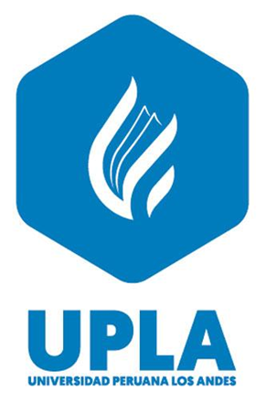

# ReservaUPLA: Sistema de Gestión de Reservas de Ambientes Universitarios



Solución de software integral para la gestión, validación algorítmica, trazabilidad y control de disponibilidad de ambientes universitarios (laboratorios de cómputo, auditorios, salas y talleres) en la **Universidad Peruana Los Andes (UPLA)**.

Desarrollado para la asignatura **Construcción de Software** (Semanas 01 a 09).

---

## 🏛️ 1. Arquitectura del Sistema (Clean Architecture)

El sistema backend sigue estrictamente el patrón **Clean Architecture** (Robert C. Martin) desacoplado en 4 capas concéntricas con regla de dependencia unidireccional:

```text
ReservaUPLA/
├── backend/
│   ├── ReservaUPLA.Domain/           # Capa 1: Entidades POCO puras (Usuario, Ambiente, Reserva)
│   ├── ReservaUPLA.Application/      # Capa 2: Casos de Uso, DTOs, Servicios y Patrón Result<T>
│   ├── ReservaUPLA.Infrastructure/   # Capa 3: Persistencia con EF Core 8 y Repositorios
│   └── ReservaUPLA.API/              # Capa 4: Thin Controllers REST y Swagger OpenAPI
└── frontend/                         # Arquitectura Basada en Componentes (React 19 + TypeScript + Vite + Tailwind CSS)
    ├── public/upla_logo.png
    └── src/
        ├── components/ui/            # Los 9 Componentes Atómicos Reutilizables exigidos (Semana 07)
        ├── components/layout/        # Header y Sidebar institucional
        ├── views/                    # Dashboard (RF-08), Reservas (RF-05,06,07), Nueva Reserva (RF-03,04), Ambientes (RF-02), Usuarios (RF-01)
        └── services/api.ts           # Cliente HTTP con fallback reactivo
```

---

## 🎨 2. Principios de Diseño, UX y Usabilidad

El frontend ha sido diseñado y validado bajo:
1. **Las 10 Heurísticas de Usabilidad de Jakob Nielsen:**
   * **Visibilidad del estado:** Badges semánticos de estado en tiempo real (Pendiente en ámbar, Aprobada en verde, Rechazada en rojo).
   * **Control y libertad del usuario:** Posibilidad de cancelar solicitudes y diálogos modales para confirmar acciones críticas.
   * **Prevención de errores:** Bloqueo de fechas pasadas, selectores acotados entre 07:00 y 22:00, y validación algorítmica preventiva de solapamiento.
   * **Reconocimiento antes que recuerdo:** Ficha técnica del ambiente visible durante la solicitud con aforo y ubicación.
2. **Las 8 Reglas de Oro de Ben Shneiderman:**
   * Consistencia cromática con la identidad institucional UPLA (`#006699`).
   * Reducción de la carga cognitiva en memoria a corto plazo.
   * Retroalimentación visual inmediata con mensajes descriptivos.

---

## ⚙️ 3. Reglas de Negocio Implementadas (RN-01 a RN-06)

* **RN-01:** Verificación algorítmica anti-solapamiento (`Inicio_A < Fin_B && Fin_A > Inicio_B`).
* **RN-02:** Registro obligatorio de motivo (mín. 10 caracteres), solicitante, ambiente, fecha y rango.
* **RN-03:** `HoraFin` estrictamente posterior a `HoraInicio`.
* **RN-04:** Horario restringido entre las 07:00 y 22:00 horas.
* **RN-05:** Solo el Administrador puede dictaminar aprobación o rechazo de reservas.
* **RN-06:** Una reserva en estado *Rechazada* es inmutable y no permite modificaciones.

---

## 🚀 4. Puesta en Marcha Rápida

### Backend (.NET 8 Web API)
```bash
cd backend
dotnet run --project ReservaUPLA.API/ReservaUPLA.API.csproj
```
* Swagger UI disponible en: `http://localhost:5060`

### Frontend (React + Vite)
```bash
cd frontend
npm install
npm run dev
```
* Aplicación web disponible en: `http://localhost:5174`
